

  

<h3 align="center">I build software that runs real businesses, and I keep it running.</h3>

  Online stores, booking platforms, AI assistants and video tools, all live in production. 
  I work AI-first: Claude Code writes most of the code. The product decisions, the testing and the responsibility are mine.

  
  
  
  
  

## What I can do for you

  <a href="https://www.fiverr.com/jegx1914/build-a-fast-landing-page-or-business-website-with-nextjs">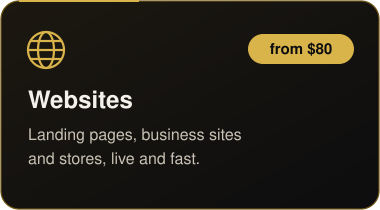</a>
  <a href="https://www.fiverr.com/jegx1914/build-an-ai-chatbot-that-answers-your-customers">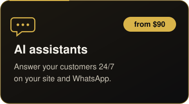</a>
  <a href="https://www.fiverr.com/jegx1914/create-short-ai-video-ads-for-reels-and-tiktok">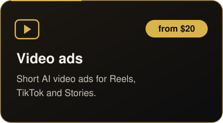</a>

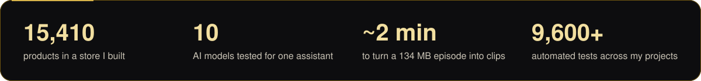

## See it working

<table>
  <tr>
    <td width="55%" align="center" valign="top">
      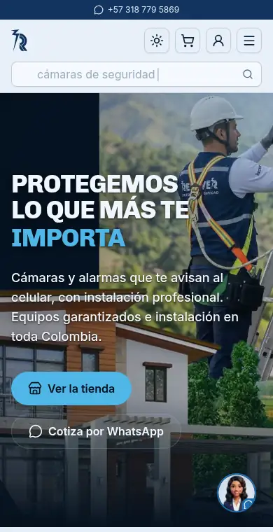 
      <b>NIA, live</b>: a customer asks which camera to buy. NIA answers with real products, prices and links in seconds.
    </td>
    <td width="45%" align="center" valign="top">
       
      <b>Video ad sample</b>: 17 seconds with a script, captions and an AI voice (demo brand).
    </td>
  </tr>
  <tr>
    <td colspan="2" align="center">
      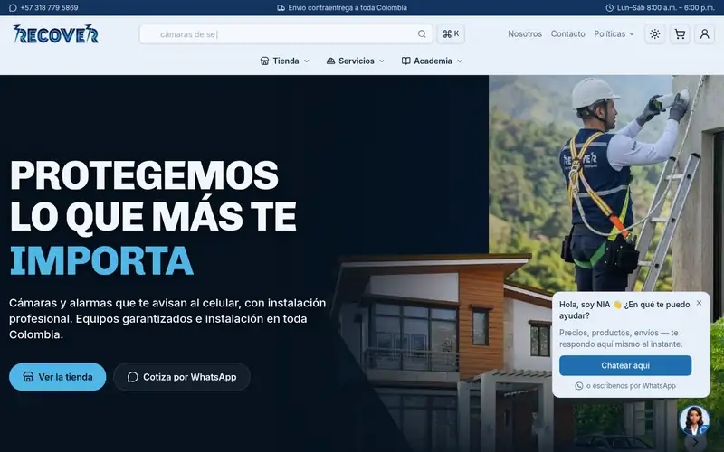 
      <b>Recover store</b>: categories, featured products and services, fast on any screen.
    </td>
  </tr>
</table>

## Things I've built, all live today

<table>
  <tr>
    <td width="50%" valign="top">
      <a href="https://recoversds.com">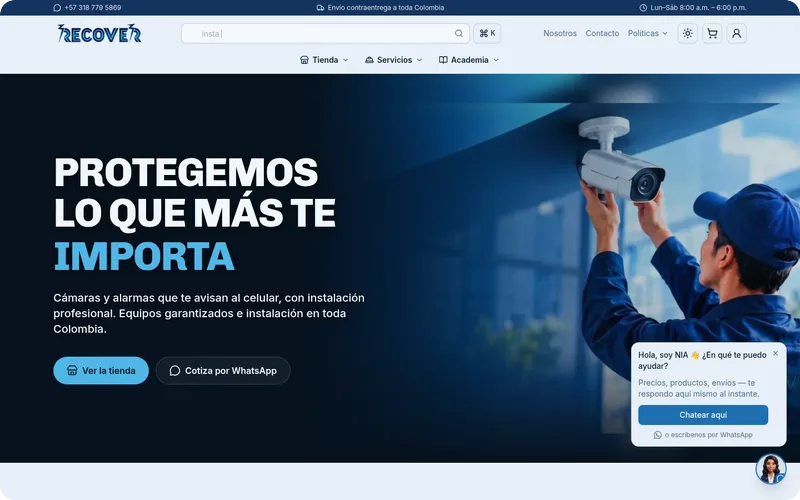</a>
      <b>Recover</b>: an online store for a security company. 15,410 products, quotes and online payments, plus <b>NIA</b>, an AI assistant that answers customers on the site and on WhatsApp.
    </td>
    <td width="50%" valign="top">
      <a href="https://esvital.group">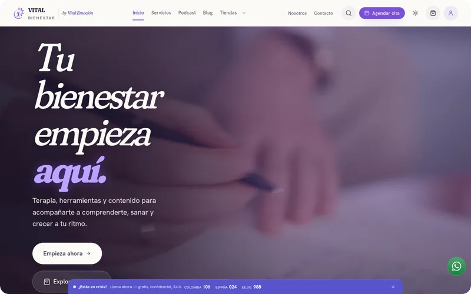</a>
      <b>Vital</b>: a booking platform for mental-health professionals. Every appointment is paid online before it is confirmed.
    </td>
  </tr>
  <tr>
    <td valign="top">
      <a href="https://prisma.cimadium.com">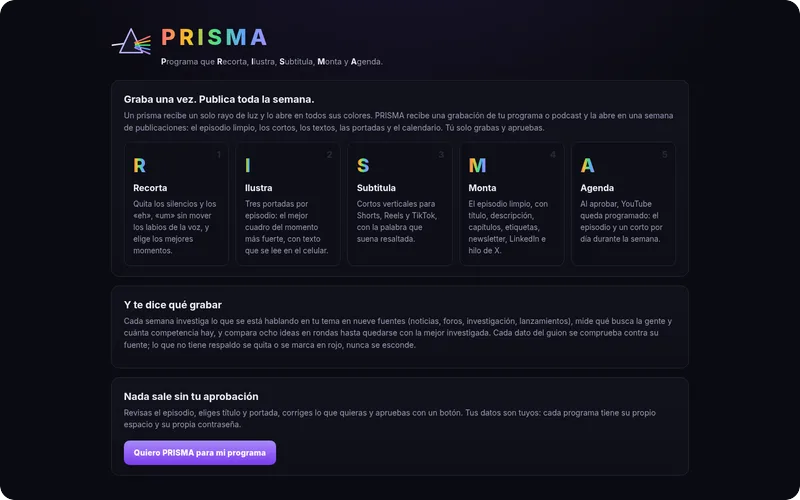</a>
      <b>PRISMA</b>: upload one video and get an edited episode, short clips, subtitles and thumbnails, ready for YouTube.
    </td>
    <td valign="top">
      <a href="https://fuentepura.co">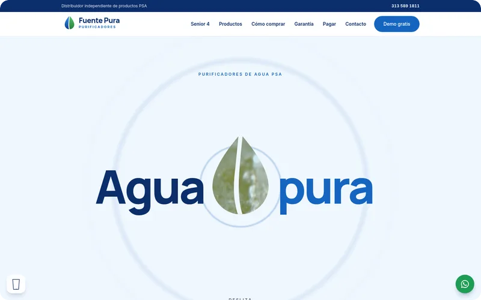</a>
      <b>Fuente Pura</b>: a website for a water purifier seller that turns visits into WhatsApp chats and free home demos.
    </td>
  </tr>
  <tr>
    <td valign="top">
      <a href="https://dagotrading.com">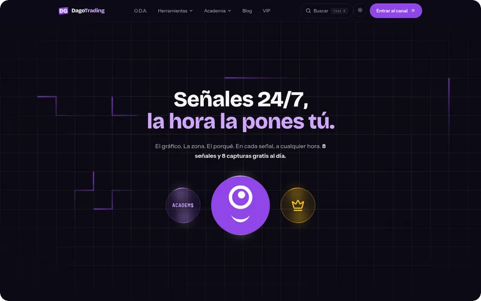</a>
      <b>DagoTrading</b>: trading signals sold as subscriptions through a Telegram bot, with card and crypto payments.
    </td>
    <td valign="top">
      <a href="https://carnudos.com">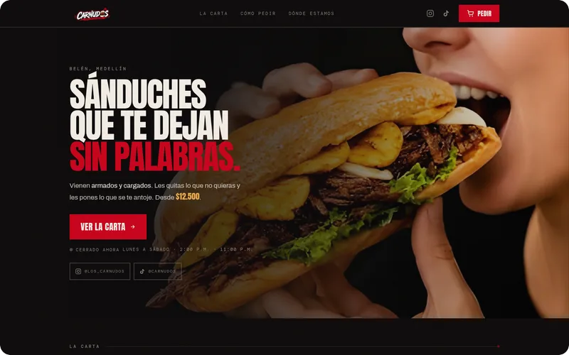</a>
      <b>Carnudos</b>: online ordering for a sandwich shop. Every order prints by itself on the kitchen printer.
    </td>
  </tr>
  <tr>
    <td valign="top">
      <a href="https://ivannaura.vercel.app">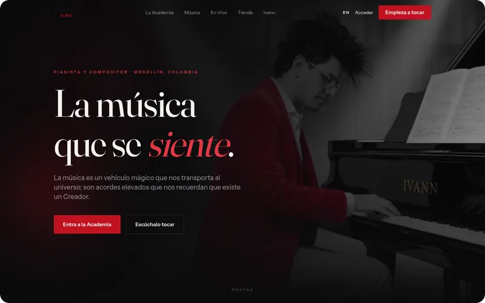</a>
      <b>Ivann</b>: a website for a pianist's music academy, with courses and lessons.
    </td>
    <td valign="top">
      <a href="https://cimadium.com">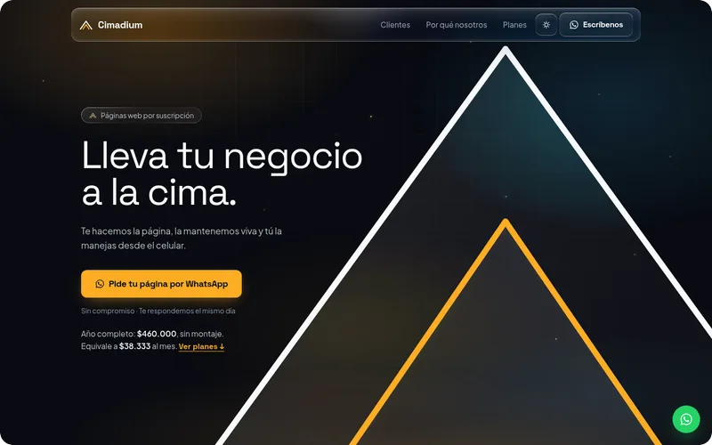</a>
      <b>Cimadium</b>: my web studio. Small businesses get a website on a simple yearly plan.
    </td>
  </tr>
</table>

## My year in code

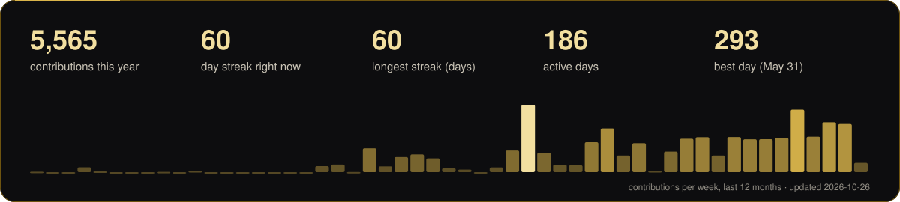

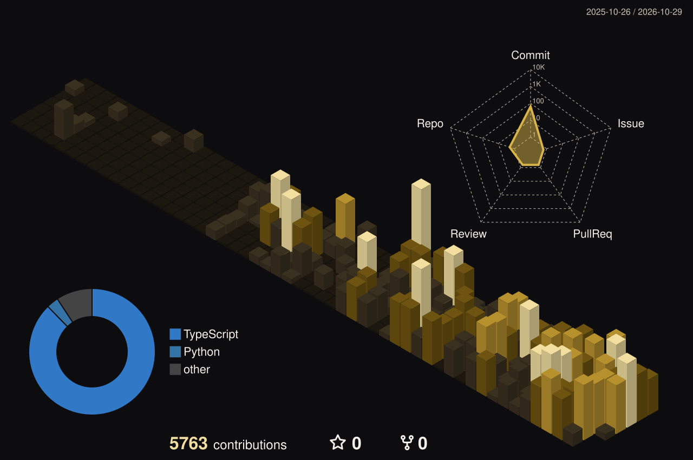

  <picture>
    <source media="(prefers-color-scheme: dark)" srcset="https://raw.githubusercontent.com/1914Jegx/1914Jegx/output/snake-dark.svg">
    <source media="(prefers-color-scheme: light)" srcset="https://raw.githubusercontent.com/1914Jegx/1914Jegx/output/snake-light.svg">
    
  </picture>

These three update by themselves every night.

## How I work

- **I measure before I decide.** For NIA I tested 10 AI models on the real project. The one I chose answered better at about US$0.002 per reply in the benchmark, while the previous model cost US$0.024 per reply in production. [Read the case study](https://github.com/1914Jegx/llm-agent-cost-benchmark).
- **Tests decide what ships.** About 9,600 automated tests across Recover, Vital and DagoTrading, and every change goes through CI.
- **I run what I build.** Payments, servers, backups and monitoring keep being my job after launch.


## Tools I ship with

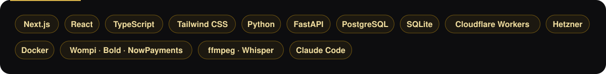

<b>En español</b>

 
Hago software para negocios reales y lo mantengo funcionando: tiendas en línea, plataformas de reservas, asistentes de IA y herramientas de video. Trabajo con IA como herramienta principal (Claude Code escribe la mayor parte del código); las decisiones, las pruebas y la responsabilidad son mías. Estoy en Colombia y trabajo de forma remota.

Contrátame en <a href="https://www.fiverr.com/jegx1914">Fiverr</a> o en <a href="https://www.upwork.com/freelancers/~010773f7062ab046c3">Upwork</a>, o escríbeme a <a href="mailto:1914jegx@gmail.com">1914jegx@gmail.com</a>.

